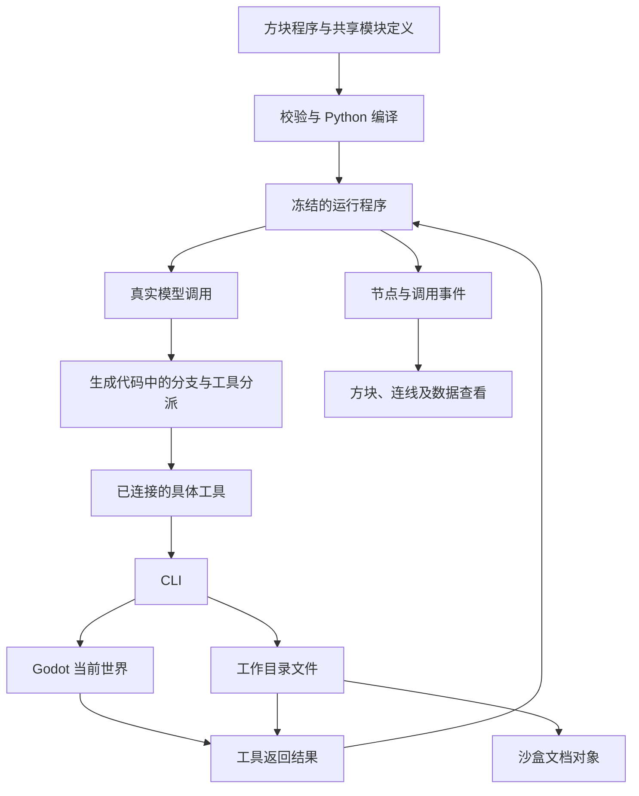

# 可执行 Agent 沙盒实施方案

日期：2026-09-22。状态：**已完成可执行首版，实际范围与证据见[验收记录](../20-验收/2026-09-22-可执行Agent沙盒.md)**。

本轮交付一台由可视化代码构成、可修改、可运行的预装 Agent。它通过具体工具读取任务文件、观察并操作沙盒，最后写出报告。方块连接、生成的 Python、真实运行和画面反馈必须对应同一份程序。

本轮不重制视频。第一课现有成片与运输运行记录保留为前一版本证据，不能用来证明本方案已经实现。

## 1. 已确认的产品规则

| 主题 | 确认结果 |
|---|---|
| 模块 | 模块就是可视化代码定义；调用节点通过接口引用定义。内部可以继续引用其他模块，不限制为固定两层或四层。 |
| 递归 | 自引用是函数调用，不是无限复制模块内部方块。支持直接递归及通过其他模块形成的递归调用。 |
| 复用 | 默认共享定义；修改后所有引用在下一次运行时更新。需要独立修改时，先复制为新定义。 |
| 编辑与执行 | 方块是唯一编辑入口，生成普通 Python 执行；代码可查看，错误与运行位置可定位回方块。 |
| 连线 | 具名端口连线，区分控制流与数据流。移动、转动、进入或退出模块不改变程序语义。 |
| 运行版本 | 启动时固定完整程序及其引用定义；运行期间编辑只影响下一次运行。 |
| 观测 | CLI 提供整个沙盒的公开结构化状态；当前不使用相机图像，也不将结构化查询称为图像识别。 |
| 工具 | 模型选择具体工具，由后端转换为 CLI 调用。连入当前 Agent 的工具才可提供给模型并实际执行。 |
| 文档 | 文件系统为准。工作目录内的文件与沙盒文档对象一一对应，沙盒编辑写回文件，外部修改同步到沙盒。 |
| 控制语义 | 结果、错误、循环、异常捕获和退出全部按可视化代码执行；不额外设置自动交还模型或自动重试规则。 |
| 输入与验收 | 保留对话框。首个任务为读取任务单、整理货物、生成报告。 |

参考 Fractal Foundry 的可复用模块与多层嵌套方式，参见 [官方介绍](https://fractalfoundrygame.com/)。本项目的具体执行语义以本次访谈为准，不从参考游戏推断实现细节。

## 2. 实施前源码核查

以下为实施开始前的源码基线，不代表交付后的新系统状态。

| 位置 | 已有能力 | 与本轮目标的差距 |
|---|---|---|
| [编译入口](../../game/scripts/compiler/compiler.gd)、[图模型](../../game/scripts/compiler/graph_model.gd) | 图、参数、控制流、数据流、校验、确定性 Python 导出 | 目前是单张实体图，没有共享模块定义、调用节点、函数接口和递归调用模型。 |
| [折叠](../../game/scripts/compiler/fold.gd) | 修改视图分组，保持编译结果不变 | 分组不是函数定义，不能据此宣称支持模块调用。 |
| [Python 生成器](../../game/scripts/compiler/codegen_python.gd) | 生成条件、循环、校验等结构 | `think`、`generate_call` 等包含示意模板；后者用随机选择生成模拟工具调用，不能接替真实模型。 |
| [世界到图](../../game/scripts/integration/world_to_graph.gd) | 从已绑定实体导出图，剔除坐标；端口名称识别控制流 | 数据端口统一降为 `any`；需要显式保存新程序的接口信息，不能靠物理端口名字猜测全部语义。 |
| [组件工坊](../../game/scripts/interaction/bright_workbench.gd)、[展开映射](../../game/scripts/interaction/unfolding_map.gd) | 26 件模型、搬移、外部源码阅读及锚点核验 | 四层源码阅读不是递归代码编辑器。现有语句锚点不能充当新程序的调用实例身份。 |
| [执行联动](../../game/scripts/interaction/execution_link.gd) | 消费已记录事件，将事件对应到语句 | 不产生执行事件，也没有调用栈与每次调用的数据。 |
| [运输环境](../../game/scripts/lessons/agent_transport.gd)、[真实后端](../../tools/lesson/run_agent.py) | 真模型选择观测、移动、装卸；环境变更与步记录 | 控制循环和工具列表手写在 Python 中，五件展示模块未决定它的执行。 |
| [文件工具](../../sidecar/mcp_sidecar/fs_tools.py) | 指定目录内的 UTF-8 文本读、写、列目录及路径检查 | 没有文件与沙盒文档对象的同步，也没有重命名、删除接口。 |
| [MCP 服务](../../sidecar/mcp_sidecar/server.py)、[桥客户端](../../sidecar/mcp_sidecar/bridge.py) | 文件和世界工具；本地文件操作可回写世界记录 | 当前是 MCP 入口，不是本轮需要的 CLI。旧桥会在部分网络错误后重发，新路径不能直接继承这种写操作语义。 |
| [世界工具](../../game/scripts/core/world_tools_core.gd) | 既有 12 个世界工具及导出入口 | 世界状态与第一课独立运输状态不是同一套状态；不能把两个快照拼接后假称统一世界。 |

## 3. 程序、世界与界面的关系

程序定义、世界状态、文件内容各有唯一来源：程序文档保存逻辑；Godot 保存当前场景状态；磁盘文件保存文档内容。三维物体与查看面板是这些数据的可交互表示。



图中的结果回路表示预装 Agent 的代码结构，不是运行器隐含的 Agent 规则。学生断开或改写这段程序，执行就随之改变。

新建 `agent_lab.tscn` 作为本轮可运行整机入口，在 F1 菜单中进入。复用运输世界规则与组件美术；现有组件工坊继续承担资产浏览，不把其固定分页展台直接当作程序编辑器。

本轮新场景使用一套权威状态和记录器。沿用第一课独立桥的部署位置，运行时与原运输场景互斥；旧 7310 桥及其 12 工具契约保持兼容。新场景内部的运输、程序视图和文档表示均由该场景对外投影，不能另维护一份 Python 世界副本。

## 4. 模块与编译契约

### 4.1 定义、调用与视图分离

下表是拟新增的数据结构，实施时需版本化保存，不能默认为旧编译器已支持的字段。

| 结构 | 必要内容 |
|---|---|
| `ProgramDocument` | `formatVersion`、入口模块 ID、模块定义集合、布局视图 |
| `ModuleDefinition` | 稳定 `moduleId`、名称、输入/输出接口、参数、内部节点、控制边、数据边 |
| `CallNode` | 稳定 `nodeId`、引用的 `moduleId`、实参连接与本调用点的参数值 |
| `PrimitiveNode` | 基本运算或外部函数调用及明确的输入、输出、异常行为 |
| `ViewState` | 节点位置、朝向、折叠状态、当前进入的模块路径；不参与语义哈希 |
| `RunManifest` | `runId`、冻结程序、全部可达定义、编译器版本、生成代码及哈希、源码映射、可用工具绑定 |

同一个模块的两处调用共享代码定义，不共享局部变量。运行事件另外带 `callId`、`parentCallId`、`moduleId`、`nodeId`；这样递归中的同一个节点也能区分不同调用。需要跨调用传递的上下文或文件句柄通过参数明确传入，不从展示方块的位置推断状态归属。

模块参数和接口使用稳定 ID，显示名可以修改。修改共享接口后，对全部引用重新校验；不能静默丢掉旧连线。进入调用节点时展示它所引用的定义，并明确提示正在编辑共享定义。

### 4.2 编译步骤

1. 从入口收集全部可达模块定义；用已访问集合结束收集，不对递归引用无限展开。
2. 校验接口、引用、实参、端口类型、必需连线、结构化控制流和变量作用域。
3. 生成模块级中间表示，保留函数调用与返回，不把模块简单展开成一张大图。
4. 每个共享定义生成一个普通 Python 函数；调用节点生成实参传递、函数调用及返回值接收。自引用和相互引用保持为函数调用。
5. 为生成语句建立 `moduleId/nodeId → 文件与行号` 映射，并插入不改变业务分支的运行事件。
6. 保存程序快照、代码与依赖清单后，启动本次运行；不再读取工作中的模块定义。

模块调用图中的循环是合法递归；数据依赖中的未定义环、没有明确控制结构的跳转环仍应报错。两者不能共用一个“有环就拒绝”的检查。

只展开、收起、移动、重命名显示标签时，语义哈希和生成代码保持不变。把一组节点**提取为新的函数定义**是程序变换：要求行为一致，但不要求 Python 字节不变；不要把它与视图折叠混为一谈。

基础节点至少覆盖赋值、取字段、构造消息、函数调用、分支、循环、返回、抛异常及异常捕获。模型 SDK、文件系统与 CLI 进程调用作为有明确契约的外部函数边界；不要求把第三方库的每一行实现转成方块，也不在外部函数里隐藏 Agent 循环。这是实现边界，不是限制模块嵌套层数。

### 4.3 真实后端的职责

将现有 `run_agent.py` 的模型通信和服务启动接入新运行器，但移除其作为整机权威的手写循环。启动器负责运行生成代码；模型适配层负责一次请求与响应；CLI 负责一次操作。消息追加、分支、循环、工具分派与结束条件都必须来自程序图。

已有模型使用结构化 JSON 选择工具，新预装 Agent 可以先沿用该接口；工具说明和参数约束由本次工具绑定生成，不能保留一份脱离图的固定提示词工具清单。真实网络调用不被示意编译模板或固定动作序列替代。

工具返回错误值时，像其他值一样沿数据流传递；函数抛异常时，按图中的 `try/except` 处理。没有捕获则正常失败退出。程序仍在循环且下一步调用模型，才会再次调用模型。运行器不追加默认修复、重试或自动回答。

预装图可明确包含步数上限节点。进程停止和超时用于中断失控执行，必须标记为中断，不能伪造正常返回；递归终止条件属于代码本身。

## 5. 工具连接与 CLI

### 5.1 连接就是实际绑定

工具节点产出具名工具绑定，沿数据端口接入当前 Agent 的工具集合。模型请求的工具说明与执行端允许的绑定来自同一份运行快照。同一个名字绑定两种实现时报编译错误。

断开 `fs.write` 后，下一次运行的模型请求不包含该工具；即使模型仍输出旧工具名，分派端也拒绝执行。当前运行继续使用启动时绑定。不要把一个位于同场景、但未连接的工具自动开放给 Agent。

模块内部的文件写入也必须经过明确的文件操作绑定，不提供能绕过工具集合的通用 shell 或任意代码执行工具。导出的 Python 是可阅读的普通代码；本轮的能力约束针对游戏中的生成与执行路径，不宣称能够约束用户在外部任意改写的 Python。

### 5.2 最小命令面

拟在现有 sidecar 包内增加 `cli.py`，支持 `python -m mcp_sidecar.cli`。新增它的理由是用户明确选择 CLI 作为世界与文件操作入口；不再增加另一套 MCP 封装。

| 具体工具 | CLI 子命令 | 行为 |
|---|---|---|
| `world.snapshot` | `world snapshot` | 当前场景的公开物体、位置、属性、连接、运输状态及文档路径/版本 |
| `world.inspect` | `world inspect` | 查询指定对象的公开属性 |
| `world.move` | `world move` | 运输车沿一个合法相邻路段移动，不附带自动寻路 |
| `world.pickup` | `world pickup` | 装载当前位置的指定货物 |
| `world.drop` | `world drop` | 在当前位置卸货 |
| `fs.list` / `fs.read` / `fs.write` | `fs list` / `fs read` / `fs write` | 操作同一个工作目录 |
| `fs.rename` / `fs.delete` | `fs rename` / `fs delete` | 同步文档生命周期；作为可选工具模块，不默认接入运输 Agent |

以上为本轮新命令面，不表示旧 12 工具已经增加这些名称。默认连接观测、运输、文件列举/读取/写入工具；模型不获得启动器或代码编辑内部接口。

命令只选择操作，参数通过 UTF-8 JSON 标准输入传递；标准输出只返回一份 JSON，诊断写标准错误。以参数数组启动子进程，不拼 shell 字符串。请求附运行与调用身份，结果附关联 ID、世界步骤和版本。

世界操作转给 Godot；文件操作复用 `ScopedFs` 的范围检查与文件逻辑。CLI 不直接导入 MCP 服务以启动另一份全局对象。既有桥的重发策略不直接用于新写操作；响应丢失时报告结果不确定并查询状态，不自动再次搬运或写文件。

公开观测使用明确字段投影，不直接把调试 `status` 或内部完整快照喂给模型。它包括整个沙盒的公开状态，但不包括评测答案、密钥、隐藏判定、后端内部变量。文件正文通过 `fs.read` 获取；世界查询提供路径与版本，避免未读文件就已从快照得到全文。

## 6. 文件与文档对象的一一对应

设置一个专门的 Agent 工作目录，通过现有 `SIDECAR_WORKSPACE` 指向它。程序快照、生成代码和运行记录放在工作目录之外，避免把运行基础设施当作任务文档。

每个普通文件对应一个文档对象，规范化相对路径是绑定键；文件夹用于分组。UTF-8 文本可编辑；其他文件仍有对象，显示类型与元数据，读取为文本失败时明确返回错误。外部链接不越出指定根目录。

| 操作 | 同步行为 |
|---|---|
| 外部新增文件 | 下次目录扫描生成文档对象；不能依赖 Agent 先读过它 |
| 外部修改内容 | 更新文件版本、对象摘要与已打开的非编辑视图 |
| 沙盒保存文本 | 写入同一文件，成功后刷新对象；文件写入失败不得只更新画面 |
| 重命名 | 旧路径绑定移除，新路径绑定建立；经自身接口重命名时可保留对象布局 |
| 外部重命名身份不明 | 按删除旧路径、新增新路径处理，不凭相同内容猜测文件身份 |
| 删除文件 | 移除对应对象；已打开的编辑草稿保留为未保存内容，不自动重建文件 |
| 同时编辑 | 保存时核对打开时的内容版本；冲突保留草稿并显示磁盘新内容，不静默覆盖 |

同步首先采用低频扫描加自身写入后立即刷新，不引入文件监控依赖。拟以 1 秒扫描间隔、普通小目录外部变化 2 秒内反映为验收目标；这是待测目标，不是已测性能。工具写入成功的响应返回后，同一场景的下一次文档查询必须读到该版本。

文件同步只更新文档表示，不自动把文件正文注入模型上下文。模型必须通过代码调用读取工具；运行记录保留当时读到的版本与内容产物引用，不能在回放时读取后来修改的文件冒充原输入。

## 7. 整机画面与运行观察

顶层呈现一台已连接的 Agent：对话入口、上下文、模型调用、工具集合、执行与结果回送均有可追踪的关系。任务单和报告是场景内可打开的文档对象，观测与运输工具指向它们实际作用的世界对象。

进入模块后，显示内部可编辑图和返回上层的路径。定义查看与运行调用查看区分开：前者修改共享代码，后者查看某个 `callId` 的输入、输出和局部状态。递归查看按调用路径进入，不一次铺开无限层级。

控制流与数据流除了颜色，还使用箭头和线型区分。线上的摘要来自真实事件；点开可查看当次传值。执行高亮由节点事件和世界操作结果驱动，不由视频时间或固定闪灯顺序驱动。

复用当前组件外观、统一表面、轨道相机、搬移与文字设施。端口和新增可见几何遵守 0.5 m 标准方块、0.25 m 落格及 0.05 m 内切倒角约定。

新增 `execution.jsonl` 存放细粒度调用事件，通过 `runId`、`eventId`、`worldStep` 与既有 schema v6 世界步记录关联；不为接入新 UI 擅自重定义旧字段。每条事件保留模块、节点、调用身份和实际输入/输出，遗漏事件显式报告。

模型请求与响应按调用单独保存，引用被冻结的工具说明和当时上下文。HTTP 鉴权字段不进入产物。世界状态、文件写入、模型调用分别记录事实，不将“模型说完成”当作任务成功。

## 8. 实施顺序与文件归属

下表路径为拟实施位置；除明确列为复用外，不能据此声称文件已经存在。各阶段属于同一交付，不以中间原型代替完整系统。

| 阶段 | 主要工作与文件 | 通过条件 |
|---|---|---|
| P1 程序模型 | 在 `game/scripts/compiler/` 新增 `module_program.gd`、`module_validate.gd`、`module_codegen.gd`；由既有 `compiler.gd` 按显式格式版本分派。新文件用于独立承载模块语义，避免把已有 700 行附近生成器继续扩大。 | 共享定义、实参、返回、嵌套、递归、分支、循环与异常能生成并执行真实 Python；旧图仍使用旧路径。 |
| P2 真实执行 | 在 `tools/lesson/` 增加 `run_program.py`、`model_call.py`；从 `run_agent.py` 提取已有模型通信能力，保留原样片入口。 | 生成代码实际控制消息与循环；换线、改条件会改变执行；运行快照和节点映射完整。 |
| P3 CLI 与同步 | 在 `sidecar/mcp_sidecar/` 增加 `cli.py`、`document_sync.py`，扩展现有文件模块；新增文件分别负责命令入口和文档目录投影。 | 真 CLI 可查询和修改新场景，文件与文档生命周期一致；断开的工具不能执行。 |
| P4 编辑与整机 | 新增 `game/scripts/interaction/module_editor.gd`、`module_ports.gd`；在 `game/scripts/lessons/` 新增 `agent_lab.gd`、`agent_lab_world.gd`、`agent_lab_documents.gd`，复用运输规则、拆分职责以保持文件上限。场景只挂根脚本。 | 真鼠标操作可进入模块、编辑共享定义、拉线、断线、保存、重开；一台完整预装 Agent 与任务环境同场可见。 |
| P5 联动与验收 | 在现有执行联动边界接入新事件，新增预装程序、任务文件与验收记录。 | 从对话启动到磁盘报告和沙盒文档形成完整证据；完成全部反例和回归。 |

依赖顺序：P1 → P2；P3 的 CLI/文件契约可在 P1 后独立完成；P4 依赖 P1 的数据结构与 P3 的对象绑定；P5 集成全部阶段。实现过程中不为单个调用点增设通用服务层。

新 GDScript 使用 `preload`，不新增 `class_name`；新增或扩展文件不得超过 800 行。旧实现的改动局限于接入点、必要提取和文档，不清理现有工作区未提交内容。

## 9. 预装程序与首个任务

预装程序的模块层次是一份可改的样例，不是编辑器写死的层级：

```text
Agent(task, tool_bindings)
  上下文初始化
  控制循环
    构造本次模型消息
    调用模型
    判断结束 / 工具调用
    校验并分派已绑定工具
      查询世界 / 运输 / 文件读写
    将结果追加到上下文
  返回回答
```

`任务.md` 写明需要搬运的货物与目标位置；对话输入“读取任务.md，完成后把结果写入报告.md”。模型自行查询、选择合法工具和路线，文件内容不预先塞进系统提示。

沿用运输开始后封路的真实环境事件，模型收到更新后的状态并选择下一步。报告至少记录读取的任务、最终货物位置、实际障碍和结果；不能在后端提前生成成功报告。

评测从磁盘任务与最终世界状态独立核对结果，确认报告存在且内容与事实一致。允许真实模型失败，失败产物也保留；不把测试用模型替身或确定性环境重放作为真实 Agent 成功证据。

## 10. 验收与停止条件

| 编号 | 必须验证的行为 |
|---|---|
| V1 | 改变位置、视角、折叠状态不改变生成代码与语义哈希；改变参数、连线或定义能影响编译结果。 |
| V2 | 两处调用共享定义；各自参数和局部状态独立。修改共享实现影响两处，复制定义后可独立修改。 |
| V3 | 多于既有四层的嵌套能编译、编辑、保存和重开；直接与相互递归能执行，事件能区分调用与返回。 |
| V4 | 同一错误值在不同图中分别流向模型、返回出口或其他分支；未捕获异常正常退出。无隐藏的自动回送或重试。 |
| V5 | 运行中修改后，本次继续使用旧定义和工具集合；下次完整采用新版本，不能混用。 |
| V6 | 拔掉写入工具：模型实际请求中没有该工具；构造该工具调用也被执行端拒绝，磁盘报告不被写入。 |
| V7 | 文件新增、外部修改、沙盒修改、重命名、删除及冲突均与表中约定一致；中文路径、子目录和越界路径行为可复现。 |
| V8 | CLI 查询反映学生刚改变的世界；文件正文不会通过未授权的旁路或世界快照提前进入模型。 |
| V9 | 实际点击模块可进入任意已存在层级；端口拉线可编辑，保存重开保持一致；运行数据沿正确调用和连线显示。 |
| V10 | 真实模型读取任务文件、完成含环境变化的整理任务并写报告；方块事件、模型请求、CLI 结果、世界记录与磁盘内容可相互核对。 |
| V11 | 既有 Godot 全量测试、sidecar pytest 与桥联调通过；新增能力有对应的新测试套件与实际窗口证据。 |

新增回归测试放入独立测试文件，并在 `tools/run_tests.sh` 的唯一映射处登记。既有测试文件不改；如遇确需改变旧测试预期的契约冲突，先记录冲突，不能改测试来掩盖回归。真实模型验收与确定性编译/环境测试分开报告。

实施结束需运行：

```powershell
& 'C:/Program Files/Git/bin/bash.exe' tools/run_tests.sh
wsl -e bash -lc 'cd /mnt/d/ai-project-lab/sidecar && ./.venv/bin/python -m pytest tests/ -q'
wsl -e bash -lc 'cd /mnt/d/ai-project-lab && bash sidecar/smoke_e2e.sh'
```

窗口验收使用 1920×1080 的真实 Godot 窗口，headless 结果不代替连线、模块进入和文档同步的交互证据。新入口命令在 P4 实施后写入启动说明，不在当前文档虚构已经可用的命令。

以下任一情况不得标记完成：只有示意动画；循环仍完全藏在手写后端；新编辑器不能保存可执行连接；递归靠无限展开；断开工具只改变画面；文档有独立于磁盘的第二份正文；报告只靠模型自述判成功；只通过旧测试而没有真实运行证据。

## 11. 当前交付边界

本次只提交实施方案、相关决策及入口文档更新。尚未新增编译器能力、编辑器、CLI 或文档同步，也未运行新的模型任务、修改运行环境或重渲染视频。下一步实施从 P1 的模块定义与函数调用开始。
